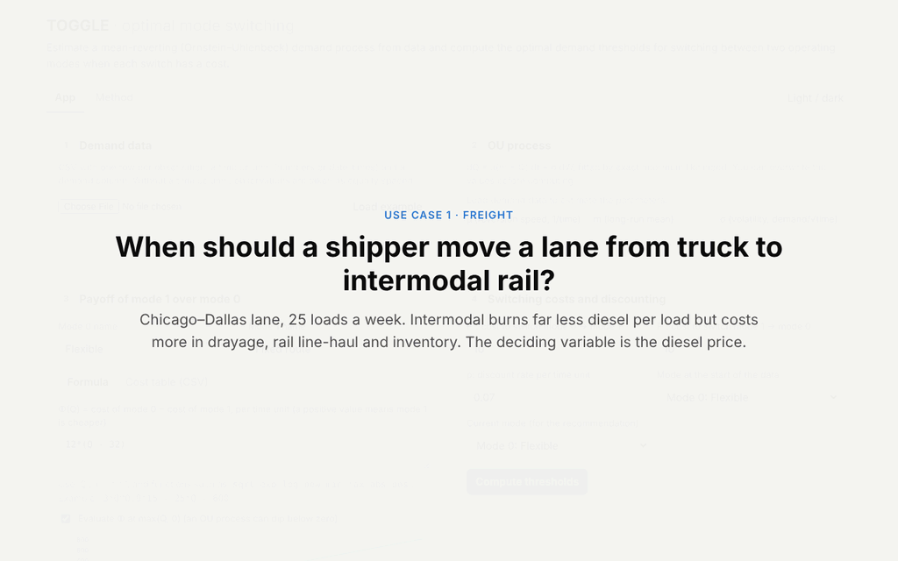
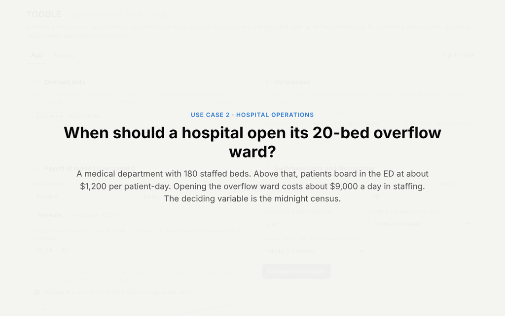

# TOGGLE

**Optimal switching between two operating modes under mean-reverting demand.**

TOGGLE is a single-file web app. You upload a time series of demand (or any mean-reverting state variable) and enter the cost of switching in each direction. TOGGLE then:

1. fits an additive Ornstein–Uhlenbeck (OU) process to the data by exact maximum likelihood, and
2. solves the entry–exit real-options problem (Dixit, 1989) for the two thresholds: switch to mode 1 when demand rises above $Q_H$, and switch back to mode 0 when it falls below $Q_L$.

The gap between the two thresholds is the *hysteresis band*: within it, the switching costs make it worth waiting rather than reacting to every fluctuation.

TOGGLE generalizes the switching model in Guo, Chow & Schonfeld (2018) to any payoff function and any additive OU process, with a corrected derivation (see [DERIVATION.md](DERIVATION.md)).

## Run it

Open `index.html` in a browser. Nothing needs to be installed or built, and all computation runs locally in the browser. The only external resource is KaTeX (from cdnjs) for the equations on the Method tab.

To host it, turn on GitHub Pages for this repository (Settings → Pages → Deploy from branch → `main`, root). The app is then served at `https://<user>.github.io/TOGGLE/`.

## Inputs

| Input | What to provide |
|---|---|
| Demand data | CSV with a demand column and, optionally, a time column (numbers or dates). Irregular spacing is handled. Choose the time unit (minutes, hours, days or weeks). |
| OU parameters | Estimated automatically: reversion speed $\mu$, long-run mean $m$, volatility $\sigma$, with standard errors. All three can be overwritten. |
| Payoff $\Phi(Q)$ | The payoff per unit time of running mode 1 instead of mode 0. Either type a **formula** in `Q` (for example `25*(102*Q - 400)`; functions `sqrt exp log pow min max abs pos`), or switch to a **cost table**: a CSV with a demand column and one cost column per mode, which TOGGLE interpolates (PCHIP or linear). |
| Switching costs | $F^+$ to switch from mode 0 to mode 1, and $F^-$ to switch back. |
| Discount rate | $\rho$ per time unit. |

## Outputs

- **Thresholds:** $Q_H$ and $Q_L$, the break-even demand $\hat Q$ and the width of the band.
- **Recommendation:** whether to switch or stay at the latest observation.
- **Charts:** the demand series with the policy applied, $\Phi(Q)$, the value difference $V_1-V_0$ against the switching costs, and the long-run distribution of demand.
- **Backtest:** the policy applied to your own data, compared with switching whenever $\Phi$ changes sign (the myopic rule) and with never switching.
- **Monte Carlo comparison:** the same policies on 400 simulated futures, with paired differences and standard errors.
- **Optimality checks:** value matching, smooth pasting, no gain from switching early, and the HJB inequalities.
- **Downloads:** the results as JSON and the policy as CSV.

## Example use cases

Both datasets in [`examples/`](examples/) are synthetic. They were generated from an OU process with parameters chosen to be realistic.

### 1. Freight: when should a shipper move a lane from truck to intermodal rail?



A shipper moves 25 loads a week on a Chicago–Dallas lane. Intermodal rail uses about 102 fewer gallons of diesel per load than truck, but costs about $400 more per load in drayage, rail line-haul and inventory. The variable that decides it is the diesel price.

- **Data:** [`diesel_weekly.csv`](examples/diesel_weekly.csv), 8 years of weekly diesel prices (416 weeks). The fit gives a long-run mean of $4.10/gal, a half-life of 16 weeks and a long-run SD of $0.37.
- **Payoff of intermodal over truck, per week:** `25*(102*Q - 400)`, which breaks even at $3.92/gal.
- **Switching costs:** $40,000 to move to intermodal (new contract, onboarding, safety stock) and $15,000 to move back. Discount rate 0.0015 per week (about 8% a year).
- **Result:** move to intermodal when diesel rises above **$4.35/gal**, and back to truck when it falls below **$2.82/gal**.
- **Simulation:** on simulated futures, the thresholds average 1.7 switches per path, compared with 332 under the myopic rule. Their expected discounted payoff is about $1.4M higher.

### 2. Hospital operations: when should a hospital open its 20-bed overflow ward?



A medical department has 180 staffed beds. Above that, patients board in the emergency department, and when boarding space runs out they are diverted to other hospitals. Opening the overflow ward adds 20 beds but costs about $9,000 a day in staffing. The variable that decides it is the midnight census.

- **Data:** [`ward_census_daily.csv`](examples/ward_census_daily.csv), 2 years of daily midnight census (730 days). The fit gives a long-run mean of 175.5 patients, a half-life of 3.5 days (a length of stay of about 5 days) and a long-run SD of 10.
- **Payoff:** read from the cost table [`ward_costs.csv`](examples/ward_costs.csv), not a formula. The table gives the expected daily cost of each configuration by census, under these assumptions:
  - $1,200 per patient-day for patients boarding in the emergency department
  - $3,000 per patient-day for diverted patients
  - $9,000 a day to staff the ward
  - surges within the day that are normally distributed with an SD of 5 patients
- **Switching costs:** $8,000 to open (agency call-in, room preparation, supplies) and $3,000 to close (cleaning, reassignment). Discount rate 0.0002 per day (about 7% a year).
- **Result:** open the ward when the census rises above **196**, and close it when it falls below **182**. The break-even census is 187.
- **Simulation:** on simulated futures, the thresholds average 67 switches per path, compared with 374 under the myopic rule. Their expected discounted payoff is about $314k higher.

## Method in brief

Demand follows $dQ_t=\mu(m-Q_t)\,dt+\sigma\,dW_t$. Let $V_0$ and $V_1$ be the values of being in mode 0 and mode 1. They satisfy

$$\tfrac12\sigma^2V''+\mu(m-Q)V'-\rho V+\Phi(Q)\,\mathbb 1_{\text{mode }1}=0 .$$

The homogeneous solutions are parabolic cylinder functions $G_\pm$, and the particular solution is $P(Q)=\int_0^\infty e^{-\rho s}\,\mathbb E[\Phi(Q_s)]\,ds$. The thresholds follow from value matching and smooth pasting at $Q_L$ and $Q_H$. TOGGLE solves these by shooting on $D=V_1-V_0$ inside the band. As $F^\pm\to0$, both thresholds converge to the root of $\Phi$. The full derivation, the estimator and the differences from the 2018 paper are in [DERIVATION.md](DERIVATION.md) and on the app's Method tab.

## Repository contents

| Path | Contents |
|---|---|
| `index.html` | The app (self-contained) |
| `DERIVATION.md` | The derivation of the additive OU switching model and the numerical method |
| `examples/` | Synthetic data for the two use cases |
| `media/` | Walkthrough GIFs |
| `LICENSE.md` | NYU non-commercial research license |

## Citation

If you use TOGGLE, please cite the paper that formulated the switching model:

> Guo, Q.-W., Chow, J.Y.J., & Schonfeld, P. (2018). Stochastic dynamic switching in fixed and flexible transit services as market entry-exit real options. *Transportation Research Part C: Emerging Technologies*, 94, 288–306. https://doi.org/10.1016/j.trc.2017.08.008

```bibtex
@article{guo2018stochastic,
  title   = {Stochastic dynamic switching in fixed and flexible transit services as market entry-exit real options},
  author  = {Guo, Qian-Wen and Chow, Joseph Y. J. and Schonfeld, Paul},
  journal = {Transportation Research Part C: Emerging Technologies},
  volume  = {94},
  pages   = {288--306},
  year    = {2018},
  doi     = {10.1016/j.trc.2017.08.008}
}
```

Other references:

- Dixit, A. (1989). Entry and exit decisions under uncertainty. *Journal of Political Economy*, 97(3), 620–638.
- Dixit, A., & Pindyck, R. (1994). *Investment under Uncertainty*. Princeton University Press.

## License

TOGGLE is released under the NYU Non-Commercial Research License (see [LICENSE.md](LICENSE.md)). It may be used and copied for internal non-commercial research and evaluation only. For commercial licensing, or for rights to modify or redistribute, contact the NYU Office of Industrial Liaison.
